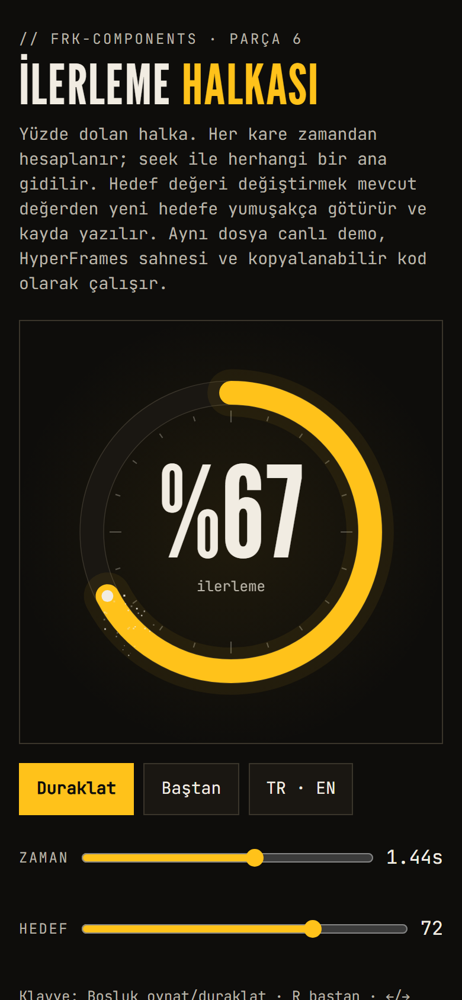
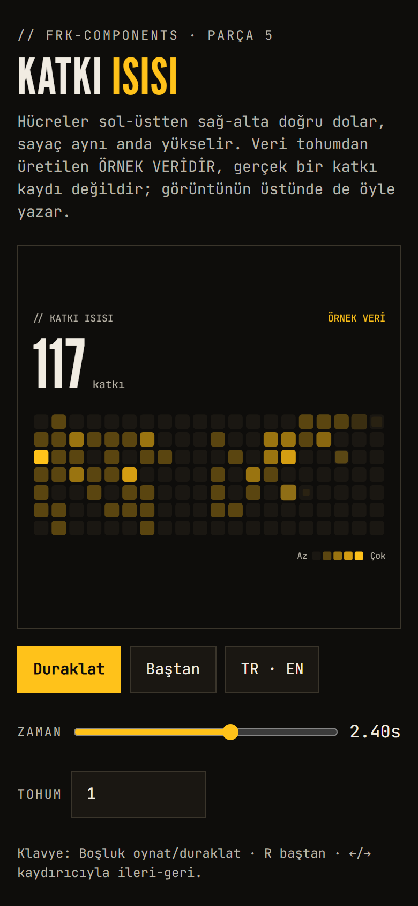
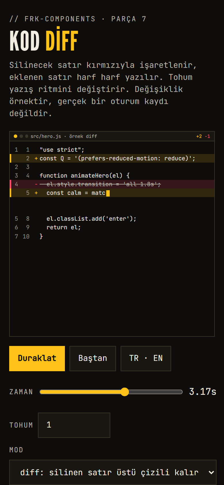
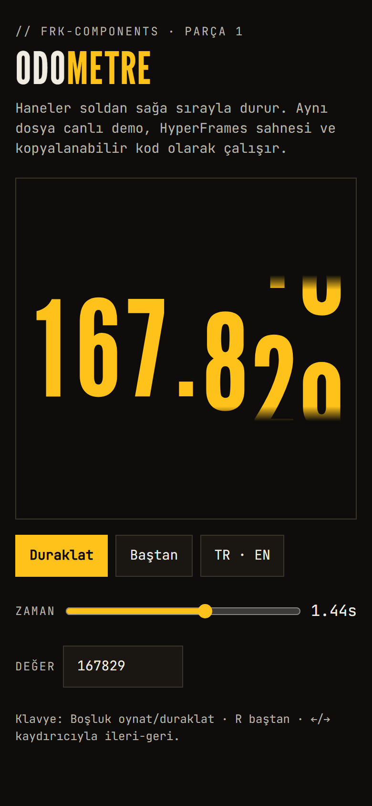
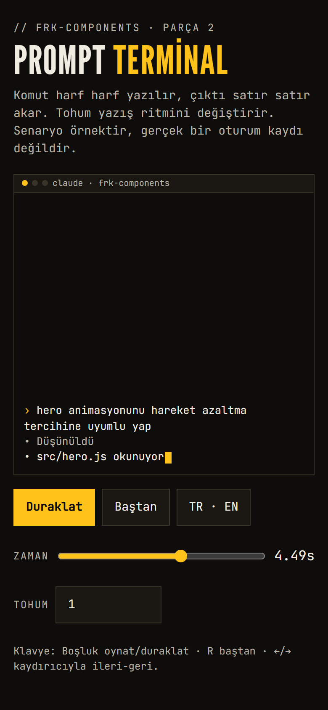
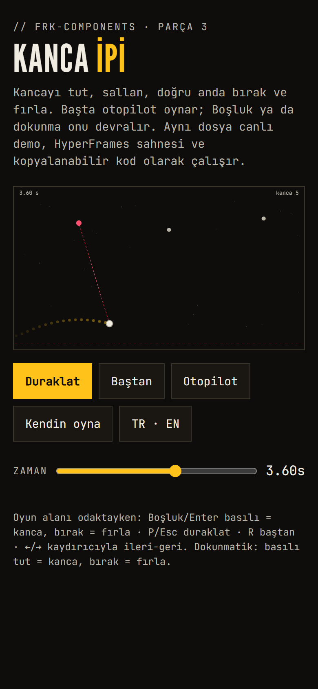
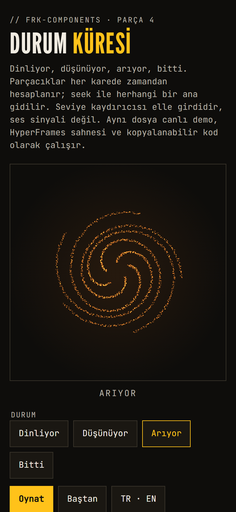

# frk-components

**TR** — Tek dosyalık, kütüphanesiz, kare kare sarılabilir arayüz parçaları. Her parça aynı dosyayla üç iş görür: canlı demo, HyperFrames video sahnesi, kopyalanabilir kod. Yanında "Claude Code ile nasıl yapıldı" reçetesi (`RECETE.md`) ve gerçek ölçümler (`olcum.json`) gelir. Depo herkese açık, lisans MIT.
**EN** — Single-file, dependency-free UI parts that can be wrapped frame by frame. Each part serves three purposes with the same file: a live demo, a HyperFrames video scene and copyable code. Each ships with a "how it was made with Claude Code" recipe (`RECETE.md`) and real measurements (`olcum.json`). The repo is public under the MIT licence.

## Parçalar / Parts

| Parça / Part | Ne yapar / What it does | Durum / Status |
|---|---|---|
| [`odometer`](components/odometer) | Haneleri soldan sağa sırayla duran sayaç / counter whose digits stop one by one | hazır, ölçüldü / done, measured |
| [`prompt-terminal`](components/prompt-terminal) | Komutun harf harf yazıldığı, çıktının aktığı terminal (örnek senaryo) / terminal with typing and streaming output (sample script) | hazır, ölçüldü / done, measured |
| [`rope-swing`](components/rope-swing) | Kanca ipi: otopilotlu, Boşluk/dokunuşla oynanan canvas oyunu / rope swing: autopilot-driven canvas game, playable with Space or touch | hazır, ölçüldü / done, measured |
| [`status-orb`](components/status-orb) | Dört durumlu (dinliyor, düşünüyor, arıyor, bitti) deterministik parçacık küresi / deterministic particle orb with four states | hazır, ölçüldü / done, measured |
| [`katki-isi`](components/katki-isi) | Zamanla dolan katkı ısı haritası; veri örnek veridir / contribution heat map that fills over time; the data is sample data | hazır, ölçüldü / done, measured |
| [`kod-diff`](components/kod-diff) | Eklenen satırın harf harf yazıldığı, silinenin işaretlendiği kod farkı animasyonu (örnek değişiklik) / code-diff animation: added lines type out, removed lines get marked (sample change) | hazır, ölçüldü / done, measured |
| [`ilerleme-halkasi`](components/ilerleme-halkasi) | Yüzde doluyor halkası: ortada tek sayı, `setValue` ile yumuşak geçiş / percent-fill ring: one number in the middle, smooth ease via `setValue` | hazır, ölçüldü / done, measured |

Hepsini bir arada görmek için `index.html`'i bir HTTP sunucusundan açın (ör. `python -m http.server`); kartlardaki ölçüm satırları `olcum.json` dosyalarını `fetch` ile okur, doğrudan `file://` açılışında tarayıcı bunu engeller. / To see them together, open `index.html` from an HTTP server; the measurement rows `fetch` the `olcum.json` files, which browsers block under `file://`.

## Video / Video

**TR** — Her parçanın 5 sn'lik HyperFrames kompozisyonu ve TR+EN render'ı `deneme/<parça>/` altındadır; yedi parçanın hepsi bir arada 30 sn'lik, 1080×1920 bir tanıtım videosu da vardır: [`deneme/vitrin-tanitim/out/vitrin-tanitim-tr.mp4`](deneme/vitrin-tanitim/out/vitrin-tanitim-tr.mp4), [`-en.mp4`](deneme/vitrin-tanitim/out/vitrin-tanitim-en.mp4). Kare determinizmi kanıtı ve yöntem: [`deneme/SONUC.md`](deneme/SONUC.md). Videolar yayınlanmamıştır; yalnız depoda durur.
**EN** — Each part has a 5 s HyperFrames composition and TR+EN renders under `deneme/<part>/`; there is also a 30 s, 1080×1920 promo video with all seven parts together (links above). Frame-determinism proof and method: [`deneme/SONUC.md`](deneme/SONUC.md). The videos are not published; they live in the repo only.

### Katalog manifestleri / Catalogue manifests

**TR** — Her kompozisyonun yanında HyperFrames kataloğunun biçiminde bir `deneme/<parça>/registry-item.json` durur (ad, tür, boyut, süre, dosyalar, önizleme). Elle yazılmaz: `node araclar/registry.mjs` boyutu ve süreyi kompozisyonun `#root` niteliklerinden, dosya listesini kompozisyonun gerçekten yüklediklerinden (bileşen betiği, `@font-face` dosyaları ve yazı tipi lisansları), başlık ve özeti bu README'den okur ve her manifesti üst akışın şemasıyla (`araclar/registry-item.schema.json`, heygen-com/hyperframes, Apache-2.0, değiştirilmeden) doğrular. `node araclar/registry.mjs --denetle` hiçbir şey yazmaz, eski ya da geçersiz manifestte 1 döner; `node araclar/registry-test.mjs` doğrulayıcının her kuralı tek tek bozulunca yakaladığını ölçer (24/24) ve üst akıştan bir katalog öğesinin geçtiğini gösterir. Kataloğa gönderilmedi; o karar ayrı.
**EN** — Next to each composition sits a `deneme/<part>/registry-item.json` in the HyperFrames catalogue format. It is generated, not typed: `node araclar/registry.mjs` reads size and duration from the composition's `#root`, the file list from what the composition really loads (component script, `@font-face` files and their font licences), title and summary from this README, and validates each manifest against the vendored upstream schema. `--denetle` writes nothing and exits 1 on a stale or invalid manifest; `node araclar/registry-test.mjs` shows that every schema rule, broken alone, is caught (24/24) and that an upstream catalogue item passes. Nothing was submitted to the catalogue.

## Ortak sözleşme / Shared contract

```js
const inst = FRKComponents.<ad>.mount(el, { seed: 1, locale: 'tr', duration: 5 });
inst.seek(2.4);   // saf: aynı t, aynı kare / pure: same t, same frame
inst.play();      // canlı demo; zamanı rAF damgasından alır / live; time comes from the rAF timestamp
inst.pause();
inst.destroy();
// el üzerinde olaylar / events on el: frk:ready, frk:tick {t}, frk:end {t}
```

- `seek(t)` çağrı sırasından bağımsızdır; HyperFrames bir GSAP zaman çizelgesiyle `seek`'i sürer. / `seek(t)` is order-independent; HyperFrames drives it from a GSAP timeline.
- Rastgelelik yalnız `opts.seed`'den (mulberry32); `Math.random`, `Date.now`, `performance.now` kullanılmaz ve bu her ölçümde kaynak taramasıyla denetlenir. / Randomness only comes from `opts.seed`; the forbidden calls are checked by a source scan on every measurement.
- `prefers-reduced-motion: reduce` altında `play()` animasyon yerine son kareyi gösterir; `seek` ortamdan bağımsız kalır. / Under `prefers-reduced-motion: reduce`, `play()` shows the final frame; `seek` stays environment-independent.
- Erişilebilirlik: kutu `role="img"` ve son durum `aria-label`; hareketli çizim `aria-hidden`. / Host is `role="img"` with the final state as `aria-label`; the moving drawing is `aria-hidden`.

<!-- galeri:başla -->
## Galeri / Gallery (390 px)

**TR** — Her parçanın demo sayfası 390 × 844 px mobil görünümde (Chromium'un mobil emülasyonu, dokunmatik, 2x yoğunluk; **gerçek telefon değil**). Kare, her parçanın süresinin %60'ında alınır. `node araclar/galeri.mjs` ile yeniden üretilir.
**EN** — Each part's demo page at 390 × 844 px (Chromium mobile emulation, touch, 2x density; **not a real phone**), captured at 60 % of each part's duration. Regenerate with `node araclar/galeri.mjs`.

<table>
<tr><td align="center" valign="top"><a href="components/ilerleme-halkasi/demo.html"></a><br><sub>İlerleme halkası / Progress ring<br>t = 1,44 sn</sub></td><td align="center" valign="top"><a href="components/katki-isi/demo.html"></a><br><sub>Katkı ısısı / Contribution heat<br>t = 2,4 sn</sub></td><td align="center" valign="top"><a href="components/kod-diff/demo.html"></a><br><sub>Kod diff / Code diff<br>t = 3,17 sn</sub></td><td align="center" valign="top"><a href="components/odometer/demo.html"></a><br><sub>Odometre / Odometer<br>t = 1,44 sn</sub></td></tr>
<tr><td align="center" valign="top"><a href="components/prompt-terminal/demo.html"></a><br><sub>Prompt terminal<br>t = 4,49 sn</sub></td><td align="center" valign="top"><a href="components/rope-swing/demo.html"></a><br><sub>Kanca ipi / Rope swing<br>t = 3,6 sn</sub></td><td align="center" valign="top"><a href="components/status-orb/demo.html"></a><br><sub>Durum küresi / Status orb<br>t = 3,6 sn</sub></td></tr>
</table>
<!-- galeri:bitti -->

## Ölçüm / Measuring

```
cd araclar && npm install        # yalnız axe-core / axe-core only
node araclar/olc.mjs components/odometer/demo.html   # olcum.json yazar / writes olcum.json
node araclar/olcum-md.mjs                            # OLCUM.md tablosu / the OLCUM.md table
```

Playwright global kurulumdan alınır (`npm root -g`). Sonuçlar [`OLCUM.md`](OLCUM.md) içinde (Firefox 155 ve WebKit 26.6 çapraz motor koşusu dahil); rakip analizindeki ölçütlere karşı durum [`KARNE.md`](KARNE.md) içinde. **Gerçek telefon, gerçek Safari/iOS ve Android Chrome ölçülmedi.** / Playwright is taken from the global install. Results are in [`OLCUM.md`](OLCUM.md) (incl. a Firefox 155 and WebKit 26.6 cross-engine run); the standing against the competitor analysis' criteria is in [`KARNE.md`](KARNE.md). **Real phones, real Safari/iOS and Android Chrome were not measured.**

## Kimlik ve lisanslar / Identity and licences

FRK-OS: siyah zemin, krem yazı, sarı vurgu, League Gothic başlık, JetBrains Mono etiket. Yazı tipleri SIL Open Font License altındadır (`assets/fonts/LICENSE-*.txt`). / FRK-OS: black ground, cream text, yellow accent, League Gothic headings, JetBrains Mono labels. The fonts are under the SIL Open Font License.

Depoda sosyal medya paylaşımı, npm yayını ve GitHub Pages yoktur. / No social posting, npm release or GitHub Pages is set up.
